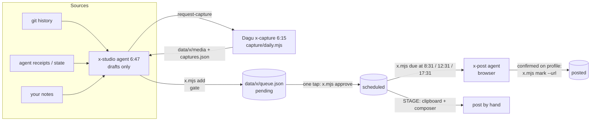

# x-build-in-public-studio

A human-approved pipeline for building in public on X: an AI agent drafts posts about work you actually shipped, a policy gate rejects anything without proof, you approve each post with one tap, and a separate agent publishes it at its slot.

It is THE FEED, the X room in Omega (my local agent dashboard), pulled out into a standalone repo: the queue CLI, the gate, the proof-capture tooling, the two agent specs, the Dagu job, and the dashboard room for reference.

## Why

Every post is meant to show real work that shipped, so every post has to be true and carry proof. Letting a model post freely would be fast and wrong. This splits the work so each part can only do one thing:

- the **writer** drafts, but can never approve or touch x.com;
- the **gate** decides what is even allowed into the queue;
- **I** approve, one tap per post;
- the **poster** publishes only what I approved, verbatim, on the right account, and records the live URL.

## Features

- **One queue, one lock.** `data/x/queue.json` is only ever written by `bin/x.mjs`, through an atomic `mkdir` lock and temp-file rename. The dashboard, the CLI and both agents share it.
- **The gate** (`x.mjs check` / `add`) rejects a draft for: over 280 characters (links counted as 23), no proof media on the first tweet, sources that don't exist on disk, a link in the main post, em/en dashes, hashtags, emails or phone numbers, about 50 phrases that read as AI-generated ("delve", "game-changer", "let that sink in"…), denylisted terms (clients, employers, money), duplicate openings, more than one video or four images, threads over 6.
- **Approval can't be automated by accident.** `approve` and `release` exit with code 4 when `RUN_ID` is set, which the agent runner exports. The dashboard API strips it, so only the owner's tap gets through.
- **Slots, not a firehose.** 8:30, 12:30 and 17:30 local, two posts a day at most, three hours apart. A slot missed by more than six hours (laptop asleep) is moved to the next free one, never dumped late.
- **Failure handling.** `fail` records the reason; the second failure parks the post as `failed` for review. `mark` only accepts a real `https://x.com/<handle>/status/<id>` URL.
- **Proof capture without a model.** `capture/capture.mjs` takes Playwright screenshots, CDP screencast recordings assembled into 30fps H.264 by ffmpeg, clips of existing videos, and 12-frame contact sheets so the writer can see what a clip shows before using it.
- **Sandbox workaround.** No Chromium starts inside the writer's sandbox, so it queues shots with `request-capture` and an unsandboxed Dagu job (`capture/daily.mjs`, 6:15 daily) takes them before the writer wakes at 6:47.

## How it works



Post lifecycle: `pending → scheduled → posted`, with `held`, `skipped` and `failed` on the side. Releasing a held draft puts it back to `pending`, never straight onto the schedule.

The agent specs in `agents/` are prompts for an unattended agent runner (Omega's loop engine runs them on Claude Code with a sandbox policy per agent: x-studio has no outbound access and no browser; x-post gets the shared browser under a lease).

## Tech stack

- Node.js 20+ (ES modules), no dependencies for the queue CLI and tests
- Playwright 1.48 and ffmpeg-static for capture (`capture/package.json`, installed separately)
- [Dagu](https://github.com/dagu-org/dagu) for the daily capture job
- Claude Code agents driven by the Markdown specs in `agents/`
- Next.js App Router + Tailwind for the dashboard room (`omega-ui/`, reference only)

## Getting started

```bash
git clone https://github.com/ianroyes-sys/x-build-in-public-studio
cd x-build-in-public-studio
npm test                     # node --test, no install needed
npm run demo                 # list the sample queue in data/example/x
```

Try the gate and the approval flow on a copy of the sample data:

```bash
cp -R data/example/x data/x          # data/x is gitignored
node bin/x.mjs check examples/draft.sample.json
node bin/x.mjs add   examples/draft.sample.json
node bin/x.mjs approve X004
RUN_ID=test node bin/x.mjs approve X003   # refused: exit 4
node bin/x.mjs slots
```

Proof capture (optional):

```bash
npm run capture:install
node capture/capture.mjs shot https://example.com example.jpg --crop 1600:900:0:0
cp capture/standing.example.json capture/standing.json   # views to shoot every morning
```

Environment variables (all optional, see `.env.example`):

| Variable | Purpose |
|---|---|
| `X_DATA_DIR` | queue/media directory, default `./data/x` |
| `X_TZ` | time zone for posting slots, default `America/Chicago` |
| `DASHBOARD_URL`, `DASHBOARD_COOKIE_NAME`, `DASHBOARD_KEY` | lets capture screenshot a local dashboard behind a cookie gate |

To schedule the capture job, copy `dagu/x-capture.yaml` into your Dagu DAGs folder and set its `working_dir`. To run the agents, point your agent runner at `agents/x-studio.md` (daily) and `agents/x-post.md` (one minute after each slot), and fill in `agents/VOICE.md`, `agents/PLAN.md` and `data/x/denylist.txt`.

## Project structure

```
bin/x.mjs              queue CLI and the gate (list, due, add, check, approve, hold, mark, fail…)
bin/x-media-serve.mjs  short-lived localhost media server for the poster's upload fallback
capture/               Playwright + ffmpeg proof capture, and the daily job that drains requests
agents/                x-studio (writer) and x-post (poster) specs, voice and plan templates
dagu/x-capture.yaml    6:15 daily capture job
data/example/x/        fake sample queue, denylist and placeholder image
examples/              a sample draft that passes the gate
omega-ui/              THE FEED room and its API routes as they run inside Omega (not standalone)
test/                  node:test suite for the gate, slots and state transitions
```

## Status

- **Queue, gate, approval and capture:** in daily use on my Mac since October 2026. The writer agent runs every morning and drafts into the queue.
- **Auto-posting is not live.** The x-post agent is written and wired, but it has not published a post: browser automation in the shared Chrome refuses to attach media to X's composer ("Not allowed"), and on some runs the profile timeline didn't render, which the spec treats as a hard stop because it can't check for duplicates. Approved posts go out by hand with STAGE.
- **Dashboard room (`omega-ui/`):** reference code that needs the Omega shell; see its README.

Built by [Ian Royes](https://github.com/ianroyes-sys)
